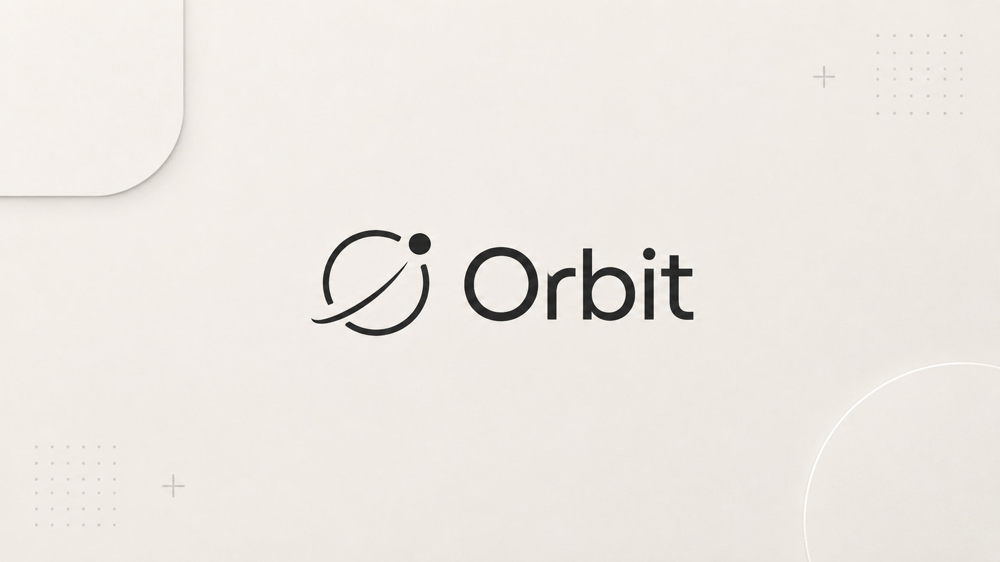

<picture><source media="(prefers-color-scheme: dark)" srcset="https://www.shieldcn.dev/github/last-commit/orbit-collective/orbit-web.svg?variant=secondary&amp;size=sm&amp;mode=dark"></picture>
<picture><source media="(prefers-color-scheme: dark)" srcset="https://www.shieldcn.dev/github/commits/orbit-collective/orbit-web.svg?variant=secondary&amp;size=sm&amp;mode=dark"></picture>
<picture><source media="(prefers-color-scheme: dark)" srcset="https://www.shieldcn.dev/github/closed-prs/orbit-collective/orbit-web.svg?variant=ghost&amp;size=sm&amp;mode=dark"></picture>
<picture><source media="(prefers-color-scheme: dark)" srcset="https://www.shieldcn.dev/badge/Package_mgr-npm-CB3837.svg?logo=npm&amp;variant=branded&amp;size=sm&amp;mode=dark"></picture>
<picture><source media="(prefers-color-scheme: dark)" srcset="https://www.shieldcn.dev/badge/Language-TypeScript-3178C6.svg?logo=typescript&amp;variant=branded&amp;size=sm&amp;mode=dark"></picture>
<picture><source media="(prefers-color-scheme: dark)" srcset="https://www.shieldcn.dev/badge/Bundler-Vite-646CFF.svg?logo=vite&amp;variant=branded&amp;size=sm&amp;mode=dark"></picture>
<picture><source media="(prefers-color-scheme: dark)" srcset="https://www.shieldcn.dev/badge/CSS-Tailwind-06B6D4.svg?logo=tailwindcss&amp;variant=branded&amp;size=sm&amp;mode=dark"></picture>
<picture><source media="(prefers-color-scheme: dark)" srcset="https://www.shieldcn.dev/badge/Stack-React-61DAFB.svg?logo=react&amp;variant=ghost&amp;size=sm&amp;mode=dark&amp;theme=purple"></picture>
[](https://app.netlify.com/projects/getorbitdev/deploys)

# Orbit Web

The marketing site and public developer docs for [Orbit](https://github.com/orbit-collective/orbit) — a self-hosted issue and project tracker. This is a separate static site, not the app itself: a landing page, `/about`, `/download`, and a `/learn` section that mirrors Orbit's own `documentation/` folder, kept in sync automatically.

## What's inside

- **Landing page** — hero, feature highlights, an interactive "how it works" walkthrough, and a scroll-driven deep dive into a few subsystems, all built from small atomic-design components (`src/components/{atoms,molecules,organisms,templates}`).
- **`/about`** and **`/download`** — static pages with the same component system, no separate CMS.
- **`/learn`** — a bilingual (EN/PL) documentation browser rendering Orbit's real `documentation/` folder as markdown (`react-markdown` + `remark-gfm`, syntax highlighting via `rehype-prism-plus`), with a collapsible sidebar, `Ctrl/Cmd+K` search over every page and section, previous/next navigation, and a "View on GitHub" link back to the source file on every page.
- **SEO baked in** — per-page `<title>`/description/canonical/`hreflang`, Open Graph + Twitter cards, JSON-LD (`SoftwareApplication`, `BreadcrumbList`), a generated `sitemap.xml`, and full static prerendering of every route (see [How the docs stay in sync](#how-the-docs-stay-in-sync) and [Prerendering](#prerendering) below).

## Tech stack

| Layer      | Technology                                          |
|------------|------------------------------------------------------|
| Framework  | React 19, TypeScript, Vite                          |
| Routing    | React Router 7                                      |
| Styling    | Tailwind CSS 4, `@tailwindcss/typography`            |
| Content    | Markdown fetched from Orbit's `documentation/` folder |
| Hosting    | Netlify (static, with a full prerender step)         |

Components follow **atomic design** (atoms → molecules → organisms → templates → pages), same convention as the main Orbit app.

## Getting started

```bash
git clone https://github.com/orbit-collective/orbit-web.git
cd orbit-web
npm install
npm run dev
```

`npm run dev` fetches the latest `documentation/` from Orbit before starting the dev server (see below) — no separate setup step needed.

## Everyday commands

```bash
npm run dev         # fetches docs, then starts the Vite dev server
npm run build       # fetches docs, builds the index and sitemap.xml, type-checks, builds, then prerenders every route
npm run lint        # ESLint
npm run preview     # preview a production build locally
npm run fetch-docs  # re-fetch documentation/ and the latest release, and rebuild the docs index
```

## How the docs stay in sync

`/learn` isn't hand-written here — `scripts/fetch-docs.mjs` does a shallow, sparse `git clone` of Orbit's `documentation/` folder into `src/content/docs/` before every dev run and build (it's gitignored in this repo). A GitHub Action in the main [Orbit repo](https://github.com/orbit-collective/orbit) calls a Netlify build hook whenever `documentation/` changes on `master`, so this site rebuilds and republishes automatically — no manual step, no drift.

Right after, `scripts/generate-docs-index.mts` turns that folder into two small generated files in `src/generated/` (also gitignored): `docs-index.json`, the whole tree with titles, descriptions and headings but **no page bodies**, and `docs-nav.json`, the English topic list the navbar menu and landing stats use. `scripts/fetch-release.mjs` writes `release.json` next to them with the latest Orbit release (it never fails the build; offline, the version badge is simply left out).

Page bodies are not bundled. Each markdown file is its own chunk, loaded when the page is opened (and warmed when its link is hovered), so the landing page does not ship the documentation. `src/lib/docs.ts` is the one place that knows about this: the tree comes from the index, the body from `loadDocContent`.

## Prerendering and hydration

Every known route (the static pages plus every `/learn` page in both languages, and `/404.html`) is rendered to real static HTML after each build — `scripts/prerender.mts`, run via `vite-node` as a `postbuild` step. That's what makes per-page titles, descriptions, and Open Graph tags visible to crawlers and link-preview bots that don't execute JavaScript, and it means the first paint is real content.

The browser then **hydrates** that HTML (`src/main.tsx`) instead of rendering again, so the prerender must produce the same tree as the client: it renders inside the same router and `Suspense` boundary as `src/App.tsx`, and anything React 19 hoists (title, meta, JSON-LD) is moved into `<head>`. If you change either side, check the browser console for a hydration warning. Avoid `useId` in components under `/learn`: the docs chunk hydrates lazily, which gives it different ids than the prerender.

Above-the-fold content uses `<Reveal eager>`, a CSS animation that plays on first paint; everything else waits to scroll into view.

## Deploying

`netlify.toml` (repository root) holds the redirects and headers: `/learn` → `/learn/en`, real 404s served from the prerendered `404.html`, and immutable caching for the fingerprinted files in `/assets`.

## Project structure

```
src/
  components/
    atoms/       Smallest building blocks (Button, Logo, Seo, ...)
    molecules/   Composed from atoms (NavLink, FeatureCard, DocsNextLink, ...)
    organisms/   Composed from molecules (Navbar, Hero, DocsContent, DocsSidebar, ...)
    templates/   Page-level layout (LandingTemplate, DocsTemplate, ...)
  pages/         Route components (HomePage, AboutPage, LearnPage, ...)
  lib/           docs.ts (the docs tree and on-demand page loading), docsSearch.ts, docsParse.ts, docLinks.ts, release.ts, cn.ts
  hooks/         useScrollSteps, useParallax, useInView, useDocContent, ...
  content/docs/  Fetched from Orbit at build time — not committed
  generated/     docs-index.json, docs-nav.json, release.json — built by scripts/, not committed

scripts/
  fetch-docs.mjs        Pulls documentation/ from the Orbit repo
  fetch-release.mjs      Looks up the latest Orbit release
  generate-docs-index.mts  Builds the docs index and nav from the fetched folder
  generate-sitemap.mts   Builds sitemap.xml from every known route
  prerender.mts           Renders every route to static HTML after build
```
